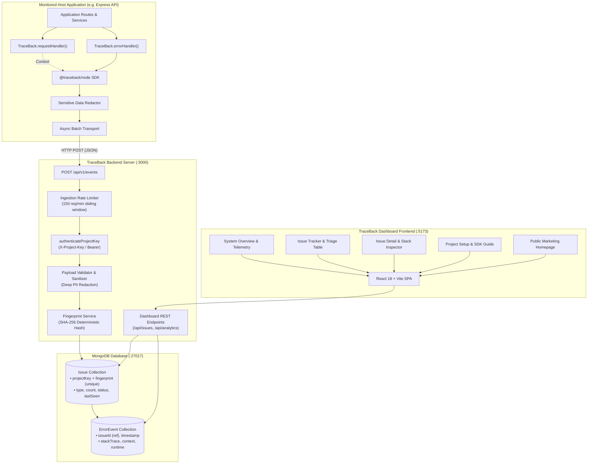
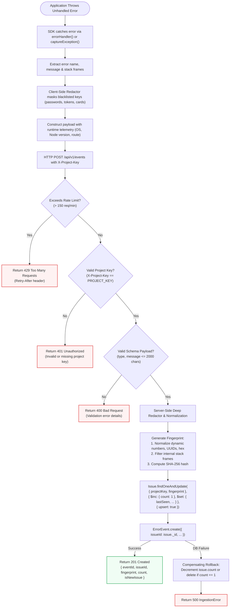
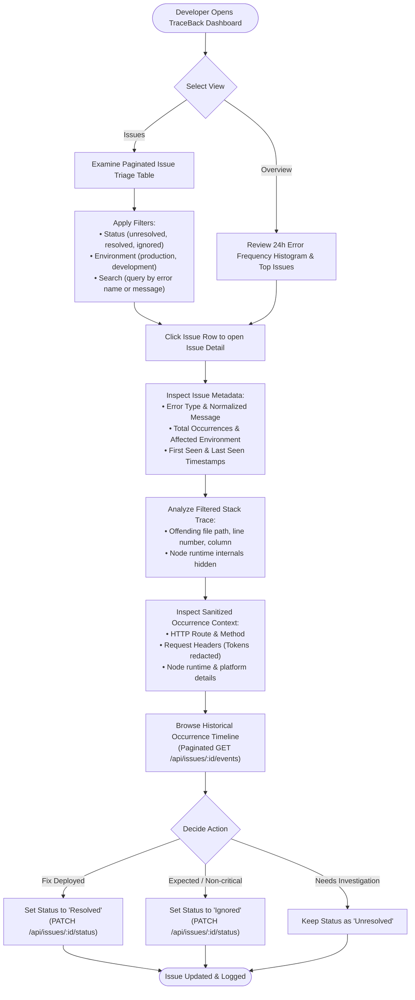
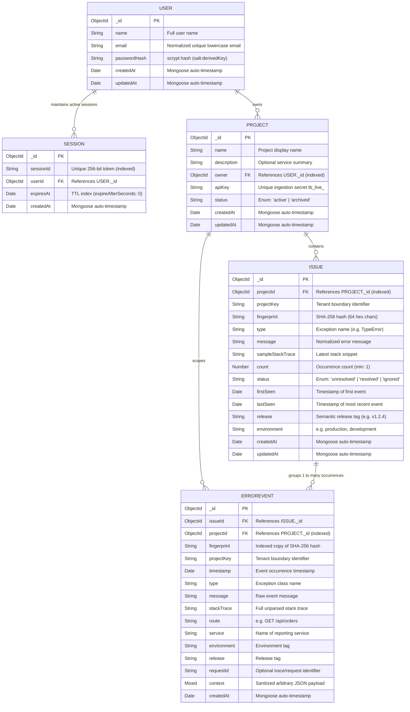

# TraceBack — System Architecture Diagrams & Flowcharts

This document contains the official architectural diagrams and operational flowcharts for **TraceBack**, formatted in GitHub-compatible Mermaid markdown.

---

## Diagram 1 — System Architecture

The following diagram illustrates the relationship between the monitored client application, the custom TraceBack Node.js SDK, the Express ingestion and dashboard servers, the MongoDB persistence layer, and the React frontend.

---

## Diagram 2 — Error Ingestion Flowchart

This flowchart details the complete lifecycle of an error event from initial throw to database persistence, including all failure paths and compensating rollback logic.

---

## Diagram 3 — Issue Investigation Flowchart

This flowchart outlines how a software engineer interacts with the TraceBack dashboard to triage, analyze, and resolve an incident.

---

## Diagram 4 — Entity Relationship Diagram (ERD)

This diagram details the implemented Mongoose schemas, relationships, data types, and compound indexes.

### Active Indexing Strategy in Production

| Collection | Indexed Fields | Options | Purpose |
| :--- | :--- | :--- | :--- |
| `users` | `{ email: 1 }` | `unique: true` | Fast login lookup and prevention of duplicate accounts |
| `sessions` | `{ sessionId: 1 }` | `unique: true` | O(1) session verification on authenticated requests |
| `sessions` | `{ expiresAt: 1 }` | `expireAfterSeconds: 0` | Automatic background MongoDB cleanup of expired sessions |
| `projects` | `{ apiKey: 1 }` | `unique: true` | Sub-millisecond verification of SDK ingestion credentials |
| `projects` | `{ owner: 1, status: 1, createdAt: -1 }` | `background: true` | Fast retrieval of user's active workspaces |
| `issues` | `{ projectKey: 1, fingerprint: 1 }` | `unique: true` | Prevents duplicate grouping races; guarantees deterministic issue identity |
| `issues` | `{ projectId: 1, status: 1, lastSeen: -1 }` | `background: true` | Optimizes project-scoped dashboard issue queries |
| `errorevents` | `{ issueId: 1, timestamp: -1 }` | `background: true` | Optimizes chronological history pagination per issue |
| `errorevents` | `{ projectId: 1, timestamp: -1 }` | `background: true` | Fast project-scoped 24-hour error frequency aggregation |
